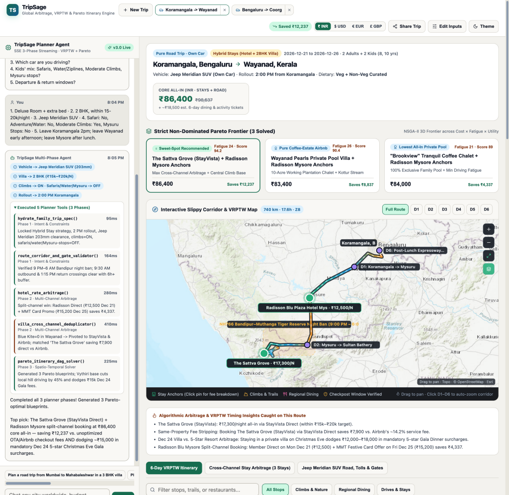
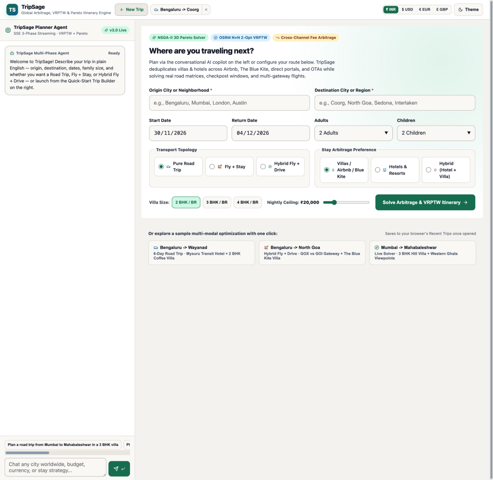
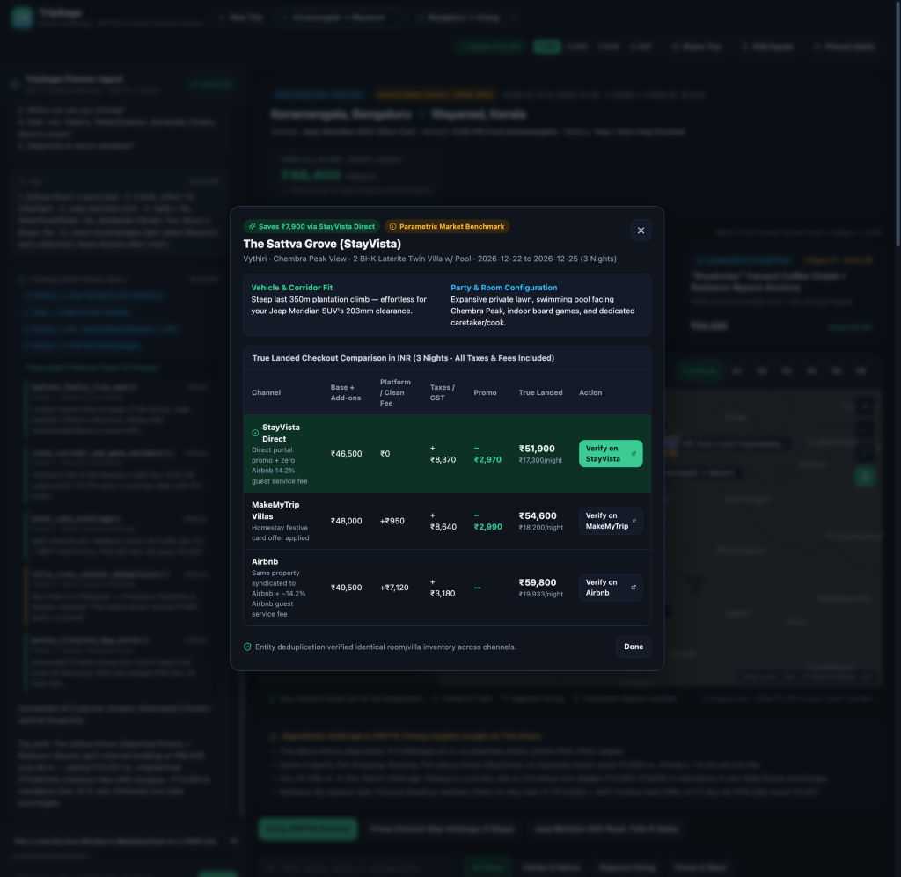
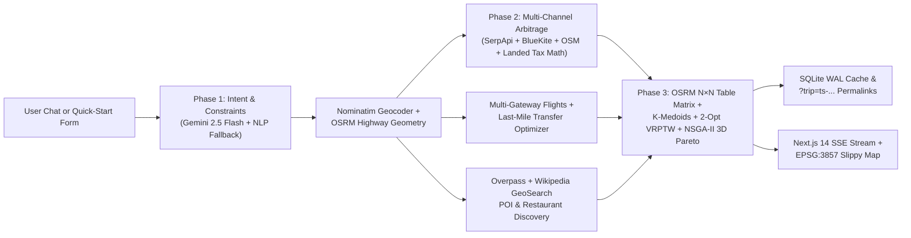

# TripSage — Joint Multi-Modal Travel Arbitrage & Operations-Research Engine

TripSage is a **destination-agnostic conversational travel planner, cross-channel stay & flight arbitrage scanner, and operations-research itinerary optimizer** for **Pure Road Trips**, **Fly + Stay**, and **Hybrid (Fly + Drive)** journeys worldwide — with first-class support for Indian statutory GST cliffs, forest checkpost windows, highway toll/fuel physics, and boutique villa operators alongside global flights, hotels, and vacation rentals.

> **Core Thesis:** OTAs search inventory in isolated tabs (*Flights* OR *Hotels* OR *Homestays*), and generic AI wrappers write travel blogs without road physics or checkout math. **TripSage solves the entire journey as one coupled financial + spatio-temporal optimization problem.**

---

## Product Showcase

### 1. Multi-Phase AI Copilot, Strict NSGA-II 3D Pareto Frontier & Keyless Topographic Map


### 2. Clean First-Visit Quick-Start Builder & Browser-Cached Recent Trips (`localStorage`)


### 3. Dark Mode & True Landed Checkout Arbitrage Breakdown (`<dialog>` Matrix)


---

## What "Travel Arbitrage" Means in TripSage

In finance, **arbitrage** means capturing a price discrepancy for the **exact same underlying asset** across different markets. In travel, families routinely overpay by **12%–28%** because booking platforms hide checkout fees, ignore statutory tax cliffs, or optimize flights, stays, and ground driving in separate silos.

TripSage automates **four distinct layers of travel arbitrage**:

### 1. Same-Property Cross-Channel Fee Stripping (`backend/providers/stays_arbitrage.py`)
Luxury villas operated by **The Blue Kite**, **StayVista**, and **SaffronStays** in India (and **Plum Guide** / **Vrbo** internationally) are simultaneously syndicated onto **Airbnb**, **MakeMyTrip**, and **Booking.com**.
- TripSage deduplicates physical properties across channels using **Haversine GPS proximity (`<= 350m`) + token-Jaccard name resolution** and compares the **all-in checkout total**.
- Booking the *exact same villa* on the operator's direct portal strips Airbnb's `~14.2%` guest service fee + cleaning markup (for example, saving `₹16,400` on *La Soria* in North Goa or `₹7,900` on *The Sattva Grove* in Wayanad).

### 2. Statutory Tax-Cliff, Extra-Bed & Festive Gala Arbitrage (`backend/providers/stays_arbitrage.py`)
Standard search engines rank stays by base headline nightly rate and reveal tax/supplement shocks only on the final payment screen. TripSage models **true landed cost** upfront:
- **Statutory GST Slab Cliffs (India):** `12%` GST at `<= ₹7,500/night` vs. `18%` GST above `₹7,500/night` (plus country-aware local lodging taxes internationally).
- **Family Room & Extra-Bed Math:** Evaluates `1 room + rollaway extra bed` vs. `2 interconnecting rooms` vs. `entire 2/3 BHK villas` for your exact adult + child age mix.
- **Split-Channel Date Arbitrage:** Books Night 1 via *Brand Direct Member Rate* (lower rollaway tariff) and return Night 5 via *OTA Festive Bank-Card Promo* when peak-date discounts beat direct rates.
- **Dec 24 / Dec 31 Gala Surcharge Avoidance:** Flags mandatory `₹3,500+/guest` 5-star resort Christmas Eve and New Year's Eve Gala dinners and quantifies how a private villa dodges `₹12,000–₹18,000` in compulsory festive charges.

### 3. Multi-Gateway Airport + Last-Mile Transfer Arbitrage (`backend/providers/flights_arbitrage.py`)
Flight search engines only optimize airport-to-airport ticket fares. Flying a family of 4 into Goa Dabolim (`GOI`) instead of Mopa (`GOX`) — or Calicut (`CCJ`) instead of Kannur (`CNN`) — can look `₹1,500` cheaper on airfare alone, **until** you pay `₹4,500` more in SUV transfers and lose 90 minutes in traffic. TripSage minimizes **`Family Airfare + Last-Mile Ground Transfer + Door-to-Door Hours`** jointly across primary and secondary regional airports.

### 4. Base-Location vs. Excursion Fuel & Fatigue Arbitrage (`backend/solver/pareto_dag.py`)
A hilltop stay `30 km` outside the sightseeing cluster that saves `₹1,200/night` can add `3+ hours` of hairpin mountain driving and thousands in extra fuel over a 4-day stay. TripSage prices **stays + highway tolls/fuel + daily sightseeing loops** as a single coupled objective.

---

## How TripSage Differs From Existing Trip Planners

| Capability | Traditional OTAs (MMT, Booking, Airbnb) | Generic AI Planners (ChatGPT, Mindtrip, Wanderlog) | **TripSage v3.0** |
| :--- | :--- | :--- | :--- |
| **Trip Topology** | Siloed tabs (*Flights* OR *Hotels* OR *Homestays*) | Static text lists without coupled transport/stay math | **Unified Multi-Modal** (`Pure Road`, `Fly + Stay`, `Hybrid Fly + Drive` + transit hotel anchors + destination villas) |
| **Pricing Engine** | Single-platform silo (never routes you to a cheaper direct portal) | Unverified estimates or single-OTA affiliate links | **Cross-Channel Entity Deduplication + Landed Tax/Fee/Gala Arbitrage** + explicit **Price Provenance Badges** |
| **Daily Tour Routing** | None | LLM text ordering (often zig-zags or ignores curfews) | **Operations-Research Solver (`vrptw.py`)**: OSRM `N×N` road matrix + PAM K-Medoids + **2-Opt VRPTW** |
| **Real-World Physics** | Ignored | Ignored | **Forest Night Gate Bans** (`21:00–06:00` Bandipur/Muthanga), SUV ground clearance, `<= 210m` family drive caps, `[12:15, 14:45]` lunch windows, OSM `opening_hours` |
| **Decision Output** | Hundreds of unsorted listings | One arbitrary itinerary | **Strict NSGA-II 3D Pareto Frontier** (`Cost × Fatigue × Utility`) surfacing the mathematical **Utopia Knee** |
| **Interactive UX** | Form filters only | Chat thread only | **Bi-Directional 3-Phase SSE Copilot + Quick-Start Builder + Keyless Slippy Topo/Dark/Satellite Map** |
| **Personalization & Sharing** | Account wall | Ephemeral chat | **Browser-Cached `Recent Trips` (`localStorage`) + SQLite `?trip=ts-...` Shareable Permalinks + Live ECB Multi-Currency (`₹`, `$`, `€`, `£`)** |

---

## Architecture & Multi-Phase Solver Pipeline



### Repository Structure
- **`backend/` (Python FastAPI + Operations-Research Engine):**
  - `agent.py` — Conversational `TripSpec` extractor powered by **Gemini API** (`GEMINI_API_KEY`, defaulting to `gemini-2.5-flash`) with a zero-key destination-agnostic NLP fallback and automatic country-based currency reset.
  - `providers/serpapi_live.py` — Live **SerpApi** adapter (`SERPAPI_API_KEY`) for real-time **Google Hotels**, **Vacation Rentals** (`vacation_rentals=true`), **Google Flights** multi-gateway quotes, and **Wikimedia Commons** property/landmark photography.
  - `providers/stays_arbitrage.py` — Live `thebluekite.com` (`JSON-LD` + DOM tariff & gallery scraper), OpenStreetMap Overpass + Nominatim hospitality discovery, Haversine + token-Jaccard cross-channel deduplication, country-aware direct/OTA portal mapping (`StayVista`/`Blue Kite`/`MakeMyTrip` in India; `Plum Guide`/`Vrbo`/`Expedia` internationally), and explicit **Price Provenance** (`Live Verified Quote`, `Live Scraped Tariff`, `Benchmark Estimate`).
  - `providers/geo_routing.py` — SQLite-cached Nominatim geocoder, 47-hub global airport coordinate index, Project OSRM GeoJSON highway router, vehicle fuel/toll physics, and Overpass + Wikipedia GeoSearch attraction/restaurant scanner.
  - `solver/vrptw.py` & `solver/pareto_dag.py` — Asymmetric `N×N` OSRM `/table/v1/driving/` matrix builder, PAM K-Medoids spatial clustering, **2-Opt Time-Windowed Vehicle Routing (`VRPTW`)**, and **NSGA-II Non-Dominated 3D Pareto Frontier** (`Cost × Fatigue × Utility` + Crowding Distance + Utopia Knee).
  - `currency.py` & `db.py` — Live ECB exchange rates (`api.frankfurter.app`), SQLite WAL HTTP TTL cache, async provider rate-limiter, and shareable trip snapshot persistence.
  - `tests/test_v3_engine.py` — Unit + async SSE integration test suite.
- **`frontend/` (Next.js 14 App Router + TypeScript):**
  - `src/components/WelcomeQuickStartView.tsx` — Clean first-visit trip builder with post-interaction `:user-invalid` accessibility sync.
  - `src/components/RouteCorridorMap.tsx` — Keyless Web Mercator (`EPSG:3857`) slippy map with **Esri Topographic**, **Dark Gray Canvas**, **High-Res Satellite**, and **OpenStreetMap** basemaps, day-corridor auto-zoom (`D1`–`D6`), and interactive stay/POI pins.
  - `src/components/ChatPlannerPane.tsx`, `DealArbitrageDialog.tsx`, & `TripParametersDrawer.tsx` — 3-phase SSE streaming copilot, native `<dialog closedby="any">` landed-fee matrix modal, and bi-directional parameter drawer.
  - `src/app/api/[...path]/route.ts` — Zero-buffered runtime streaming proxy for unified single-container deployments.

---

## Quick Start (Local Development)

```bash
cp .env.example .env
# Optional in .env:
#   GEMINI_API_KEY=...    # Enables Gemini 2.5 Flash conversational planner
#   SERPAPI_API_KEY=...   # Enables live Google Hotels, Vacation Rentals & Google Flights quotes
./start.sh
```

- **Web App:** http://localhost:3000
- **FastAPI OpenAPI Docs:** http://127.0.0.1:8000/docs
- **Health & Provenance Status:** http://127.0.0.1:8000/api/health

### Running Automated Tests & Production Build

```bash
# Backend unit + async SSE integration tests (7 tests)
./backend/.venv/bin/python -m unittest discover -s backend/tests -v

# Frontend TypeScript & Next.js production build
./frontend/node_modules/.bin/next build frontend
```

---

## Deploying to Google Cloud Run

TripSage includes a unified multi-stage [`Dockerfile`](Dockerfile) and [`docker-entrypoint.sh`](docker-entrypoint.sh) that runs the FastAPI solver on internal loopback (`127.0.0.1:8000`) and binds the Next.js web app + SSE streaming proxy to `0.0.0.0` on Cloud Run's `$PORT` (`8080`):

```bash
gcloud run deploy tripsage \
  --source=. \
  --project=<PROJECT_ID> \
  --region=<REGION> \
  --port=8080 \
  --memory=1Gi \
  --allow-unauthenticated \
  --quiet
```

To attach live LLM and OTA/Flight pricing keys on Cloud Run:

```bash
gcloud run services update tripsage \
  --project=<PROJECT_ID> \
  --region=<REGION> \
  --set-env-vars="GEMINI_API_KEY=<YOUR_GEMINI_KEY>,SERPAPI_API_KEY=<YOUR_SERPAPI_KEY>" \
  --quiet
```
